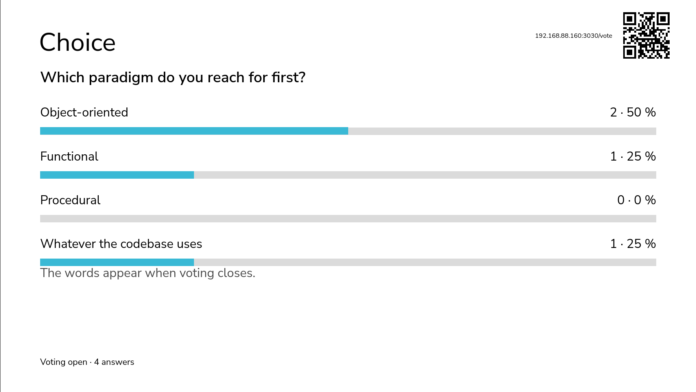
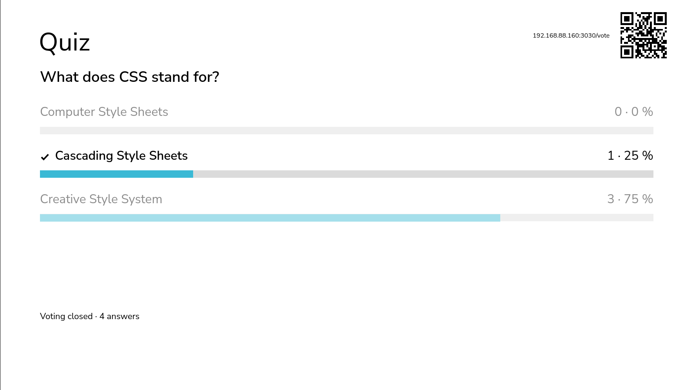
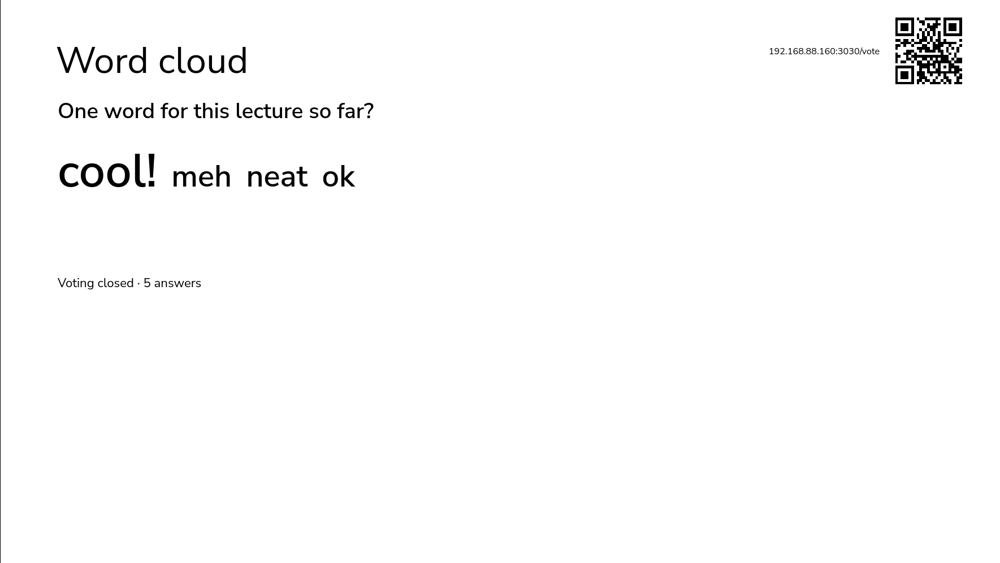
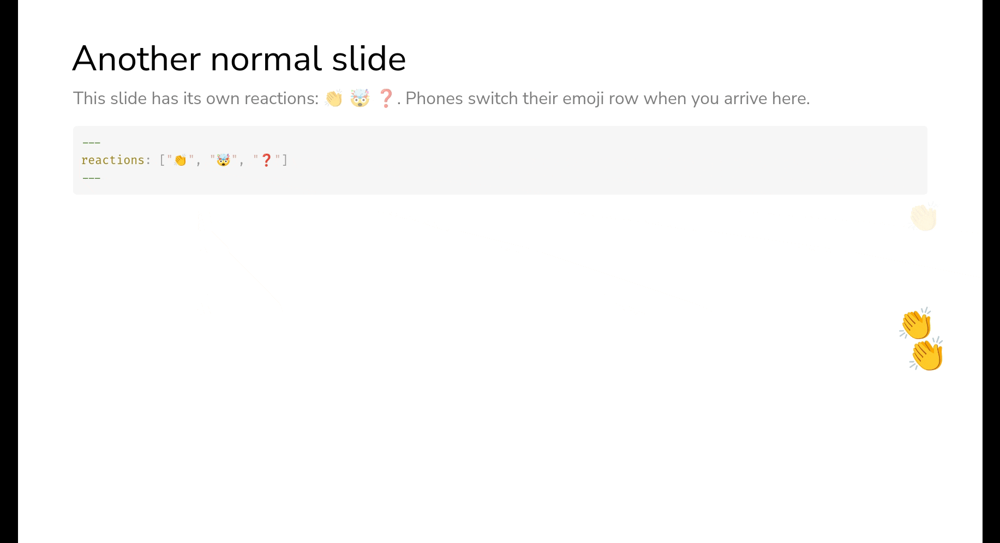

# slidev-addon-polls

[](https://oss.korext.com/ai-license)

Simple live polls for [Slidev](https://sli.dev) slides. Easy to set up, works via dev server or as a standalone.

<div align="center">
<video src="https://github.com/user-attachments/assets/debf54d3-6469-4dad-ad90-9fa196df4d1c"></video>
</div>

No extra server: the poll backend runs inside Slidev's own dev server.

## Quick start

1. Install from GitHub using your favourite package manager, e.g.:

   ```bash
   npm install github:dezhidki/slidev-addon-polls
   ```

2. Add the addon to your deck's headmatter and put a poll on a slide:

   ```md
   ---
   addons:
     - slidev-addon-polls
   ---

   <Poll question="Tabs or spaces?" :options="['Tabs', 'Spaces']" />
   ```

3. Start Slidev with a presenter password: `slidev --remote=your-password`
4. Open the **presenter view** and click **Open voting** under the poll.
5. The audience scans the QR code on the slide, or opens `/vote`.

## Supported poll types

|                                      |                                     |
| ------------------------------------ | ----------------------------------- |
|      |       |
| **Polls**                            | **Quizzes**                         |
|  |  |
| **Word clouds**                      | **Reactions**                       |

### Poll

```md
<Poll question="Tabs or spaces?" :options="['Tabs', 'Spaces']" />
```

Required options

- `question` (string): the question to show
- `options` (array): the answer options

Notes:

- You can add more polls to the same slide by simply adding multiple `<Poll/>` elements.
  They (usually) should stack nicely.
- **Keep answers when you move or edit a poll:** give it an `id`, unique in the deck:
  `<Poll id="tabs" question="Tabs or spaces?" … />`. Without one, a poll is known by its
  slide number and question, so inserting a slide before it or rewording its question
  starts it afresh. Either way, changing the number of options does too. Other edits keep
  the answers, counted by position: reordering options moves their votes to other options.
- **Big "join now" QR code:** `<PollQr class="w-60" />` shows only the QR code. Put it on
  an early slide so the back rows can scan it.

#### Set poll ID to keep the answers saved

By default, the poll is identified by slide number, question and option contents.
This means that changing any one of them will reset the poll, which may be annoying if you tend to edit polls live.
To preserve poll answers while allowing to change poll position or contents, give the poll an ID:

```md
<Poll id="my-poll-1" question="Speed of an unladen swallow?" :options="['European?', 'African?']" />
```

#### Hide poll answers until poll end

By default, a non-quiz poll's answers are shown on the slides live during voting.
To show the results after the voting is closed, use `blind` option:

```md
<Poll question="Which talk next?" :options="['Rust', 'Go']" blind />
```

### Quiz

A quiz is just a poll with the correct option specified using the `correct` attribute:

```md
<Poll question="What is 2 + 2?" :options="['3', '4', '5']" :correct="1" />
```

Notes:

- The presenter's view has a separate "Review answer" button that reveals the answer after the poll closes.
- Quizzes are always `blind` by default, i.e. the answers aren't shown until the poll is closed.

### Word cloud

Leaving out the `options` attribute turns the question into a word cloud:

```md
<Poll question="What do you think of me?" />
```

Notes:

- During the vote, the presenter can moderate the answers. Clicking on the answer in presenter view removes it and bans the word.
- The word cloud is `blind` by default to allow the abovementioned moderation.

## Other cool features

### Use `<PollSet />` to chain questions

`<PollSet>` allows to specify multiple polls that are chained together.
The chained polls are shown one at a a time; moving to the next fragment moves to the next poll.

This is mainly useful if you want to fit multiple (e.g. 3+) polls on the same slide and maybe also have
some other content shown at the same time (e.g. a piece of code).

```md
<PollSet :polls="[
  { question: 'First line of output?', options: ['3', '1', 'lift-off'], correct: 2 },
  { question: 'And the last line?', options: ['3', '1', 'lift-off'], correct: 0 },
]" />
```

### QR code

By default, a QR code is shown on all pages that have polls.
It sits in the top right corner, next to the title, with its address beside it. It fills
the empty band above the slide content, so it never overlaps the content and is the same
size on every slide with a one-line title. A long title wraps before reaching it.

On a slide without a title, or with a theme that leaves little room above the content,
the code keeps its full size and the poll makes room for it.

To stay readable at that size, the code uses the lowest error-correction level and an
upper-case scheme and host (QR codes store capitals more densely).

Size one poll's code with the `qrSize` prop:

```md
<Poll question="Tabs or spaces?" :options="['Tabs', 'Spaces']" qr-size="180px" />
```

Or set the defaults for the whole deck in its `style.css`:

| Variable          | Does                                 | Default |
| ----------------- | ------------------------------------ | ------- |
| `--poll-qr-size`  | Its size, capped by the title's band | `140px` |
| `--poll-qr-top`   | Distance from the top                | `12px`  |
| `--poll-qr-right` | Distance from right                  | `32px`  |

If you also want to add a separate QR code (e.g., on the first slide), you can use the `<PollQr />` component:

```md
`<PollQr class="w-60" />`
```

### Reactions

The voting page has a row of emoji. Tapping one floats it up the side of the slide. In
presenter mode, a corner of the slide counts reactions per slide, so "thumbs up if this
made sense" is readable at a glance.

Defaults: on, with 👍 👎 🤔 ❤️, and one reaction per person every 3 seconds. Change them
for the whole deck in the headmatter, or for one slide in its frontmatter:

```yaml
reactions: false # turn off
reactions: ["👏", "🤯", "❓"] # your own set
reactionCooldown: 1 # seconds between reactions per person (default 3)
```

Notes:

- The server enforces the cooldown per person, not per connection. Reloading or opening
  a second tab does not skip it.
- The server only accepts emoji that the current slide lists.
- A flood of reactions thins out on screen instead of slowing it down.
- People who prefer reduced motion see the counts without the floating.

## Running a poll

The controls appear under each poll, in presenter mode only:

- **Open voting / Close voting**: phones can answer only while voting is open, once per
  person. Until voting closes they can change their answer, e.g. after a misclick.
- **Reveal answer** (quiz only): closes voting and marks the right option everywhere.
- **Reset**: clears the answers. Click it twice within 3 seconds, so a misclick is safe.

Answers are kept in memory for as long as the slidev server is running.

## Setting the voting page URL

The QR code and address on the slides come from the first of these that applies:

1. `pollUrl` in the headmatter. Set this when your public address differs from the one
   you browse, e.g. with `slidev --remote --tunnel`:

   ```yaml
   pollUrl: https://something.trycloudflare.com/vote
   ```

2. The address you opened the slides at, unless it is `localhost`.
3. The dev server's LAN address.

Phones must be able to reach that address. Some networks block devices
from reaching each other. There, use `--tunnel` or host the deck on a server.

## PDF export

The PDF export _should_ generally work via `slidev export`.
The PDF export prints each poll as its question and lettered options only: no bars, QR
code or controls. A `<PollSet>` prints all its questions one under another, or one per
page with `--with-clicks`.

## Polls with static builds

You can technically get polls working with static Slived slides.
Running `slidev build` with the addon enabled will place the voting page `vote/index.html` into the build output folder.
In addition to that, you will need to run your own polling backend as follows:

1. Run the standalone backend:

   ```bash
   PORT=3031 TOKEN=your-remote-password node node_modules/slidev-addon-polls/server/standalone.ts
   ```

   The server is TypeScript that Node runs as it stands (v22.18+ or v23.6+). On an older
   Node, add `--experimental-strip-types`.

2. Proxy `<deck url>/polls` to it, including WebSocket upgrades.

## Development

```bash
npm install     # also builds the voting page
npm run build   # rebuild dist/vote.html after changing server/vote.*
npm run dev     # demo deck with --remote (builds first)
npm test        # the protocol's parsers and the server
npm run typecheck
npm run lint
```
